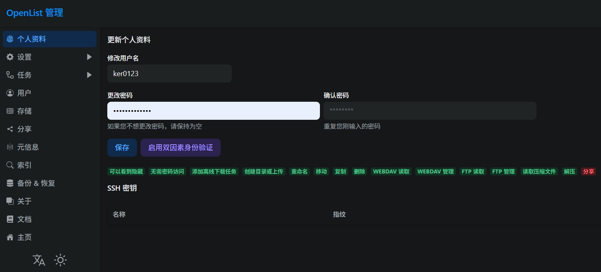
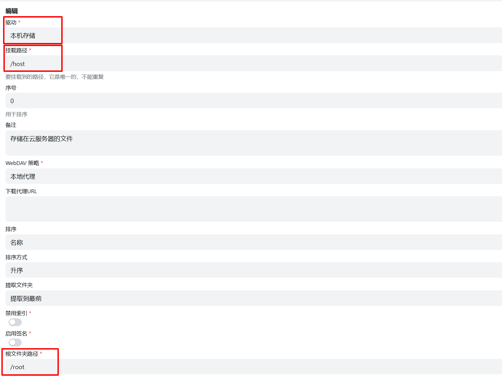
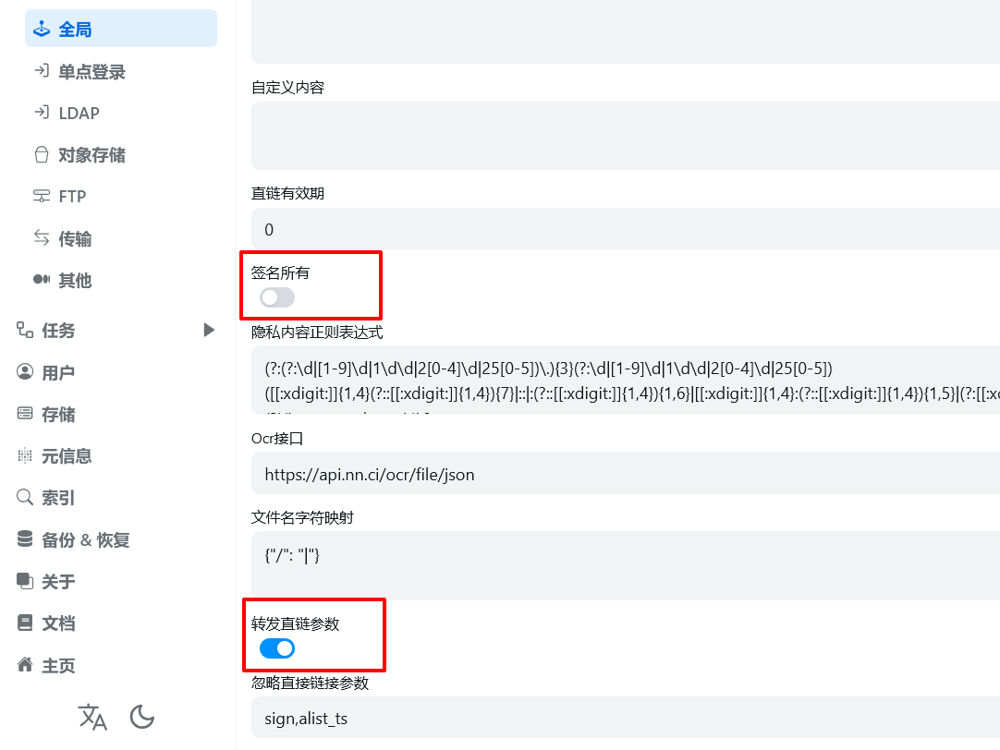
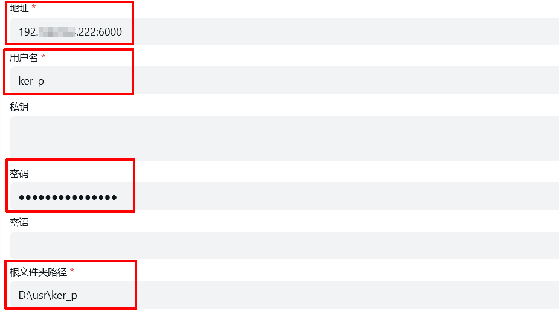
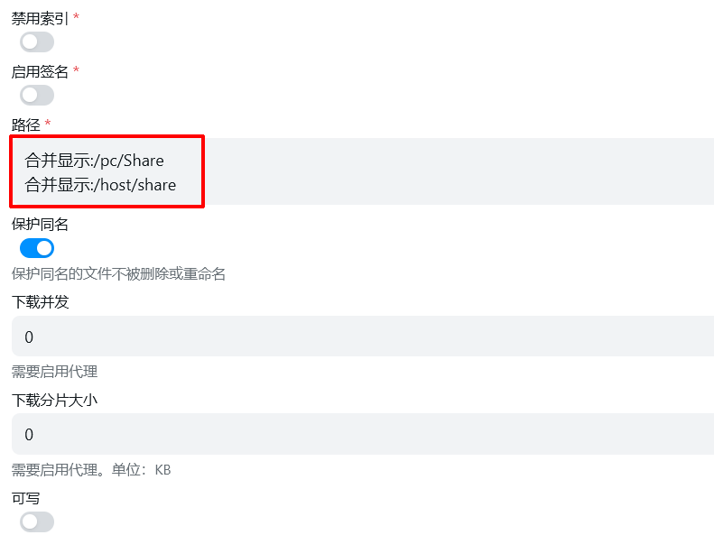
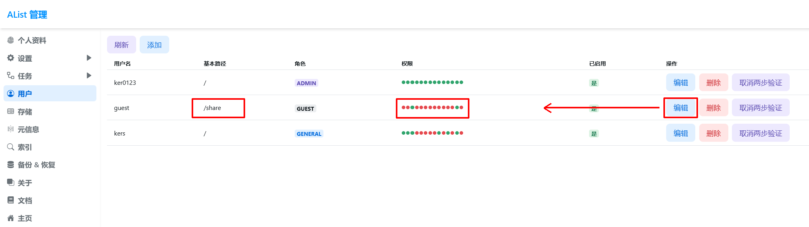

OpenList, 以前叫 Alist. 是一个开源的网盘托管**服务端**软件. 使用者可以把 *百度网盘*, *123 云盘*, *Google Drive* 等网盘服务放到一处统一管理.

本文主要记录我自己使用 OpenList, 将服务器变成网盘, 通过 SFTP 将个人电脑(的部分文件)变得可以公网访问, 以及搭建一个简易版图床, 为文件分别设置权限的过程.

## 安装

参考 [官方文档](https://alistgo.com/zh/guide/) 进行 [一键脚本安装](https://alistgo.com/zh/guide/install/script.html) 或者 [手动安装](https://alistgo.com/zh/guide/install/manual.html).

如果服务器没有配置代理, 从 github 下载安装包可能较慢. 可以试试使用这个项目: [clash-for-linux-install](https://github.com/nelvko/clash-for-linux-install) 为你的服务器配置代理, 或者使用其它任意手段下载安装包并上传到服务器.

### 一键脚本安装

#### 安装

```sh
curl -fsSL "https://alistgo.com/v3.sh" -o v3.sh && bash v3.sh
```


#### 管理面板

使用命令：`alist` 或者 `alist-manager`

### 手动安装

在 [AList Release](https://github.com/Xhofe/alist/releases) 获取对应系统的安装包.

在 Linux 系统上, 使用以下命令安装  
```sh
# 解压下载的文件，得到可执行文件：
tar -zxvf alist-xxxx.tar.gz
# 授予程序执行权限：
chmod +x alist
# 运行程序
./alist server
```

### 修改密码

需要导航到 alist 的安装目录. 一键脚本安装时默认为 `/opt/alist` (可以在安装时手动设置, 参考 [Alist 文档](https://alistgo.com/zh/guide/install/script.html)); 手动安装时, 安装位置为解压出来的目录位置.

```sh
# 获得管理员信息 以下两个不同版本，新版本也有随机生成和手动设置
# 低于v3.25.0版本
./alist admin

# 高于v3.25.0版本
# 随机生成一个密码
./alist admin random
# 手动设置一个密码 `NEW_PASSWORD`是指你需要设置的密码
./alist admin set NEW_PASSWORD
```

如果你已经可以通过浏览器访问 OpenList 生成的网页, 你也可以尝试直接使用默认帐号 `admin` 和密码 `admin` 登录. 然后点击页面下方的 [管理] 按钮, 可视化地编辑帐号密码.

*上述方法仅在文章发布时(2025-05-29), AList 验证可用, 不保证后续的 OpenList 是否仍然可用*

### 开始使用

启动 OpenList 之后, 它默认在 5244 端口上提供服务. 最简单的方式是通过网址 `http://192.xxx.xxx.xx:5244/`(192.xxx.xxx.xx是你的服务器公网IP) 直接访问服务.

当然, 你可以配置反向代理, 浏览器证书, 以更优雅的方式访问你的 OpenList 服务. 这是作者的 openList 服务访问链接 和 ngnix 配置:

```sh
# pan.kers.site 的 HTTPS 代理到 openlist 云盘服务
server {
    listen 443 ssl http2;
    listen [::]:443 ssl http2;
    server_name pan.kers.site;

    ssl_certificate     /etc/ssl/certs/full_chain.pem;
    ssl_certificate_key /etc/ssl/private/private.key;

    ssl_protocols       TLSv1.2 TLSv1.3;
    ssl_ciphers         HIGH:!aNULL:!MD5;

    # 文件上传大小限制（openlist 需要）
    client_max_body_size 10G;

    location / {
        proxy_pass http://127.0.0.1:5244;
        proxy_set_header Host $host;
        proxy_set_header X-Real-IP $remote_addr;
        proxy_set_header X-Forwarded-For $proxy_add_x_forwarded_for;
        proxy_set_header X-Forwarded-Proto $scheme;

        # WebSocket 支持（openlist 可能需要）
        proxy_http_version 1.1;
        proxy_set_header Upgrade $http_upgrade;
        proxy_set_header Connection "upgrade";

        # 超时设置
        proxy_read_timeout 3600s;
        proxy_send_timeout 3600s;
    }
}

```

默认账号密码可能是 `admin`, `admin`. 如果之前修改过, 则以修改后的为准.

登录成功后从页面下方的[管理]按钮, 进入管理界面. 在这里你可以重新设置帐号密码, 或者创建新的帐号并为其分配权限, 或者设置访客的权限...



在存储界面, 选择 [添加], 以添加各式各样的存储器. 这是 OpenList 的主要功能. 你可以访问 [Alist 文档的添加存储章节](https://alistgo.com/zh/guide/drivers/), 查看各种存储器的配置细节.

当前有很多可用的存储器类型, 自建服务的包括 FTP, SFTP, WebDAV, SMB 等. 第三方包括 Github Release, 阿里云, 电信/联通/移动云盘, 123 网盘, 百度网盘, 蓝奏云, 谷歌云盘, 腾讯微云, 网易云音乐云盘...

## 配置

### 将服务器作为"云盘"

如果考虑将某些文件存储在服务器, 并希望任何人都能通过浏览器, 浏览和下载这些文件. 那么可以考虑使用 [本机存储] 功能.

添加方式很简单, 通过浏览器访问 OpenList 生成的网站



### 通过 FTP 访问服务器文件

### 将服务器作为简单图床

首先要在 `设置 > 全局` 中关闭[签名所有]选项, 打开[转发直链参数]选项. 之后便可以右键文件, 选择分享, 生成直链来使用了.



另外, 记得配合元信息为不想分享的文件夹设置密码, 防止外界可以不登录, 就通过轮询直链访问云盘内的所有文件.

请确保可以公开的文件, 右键分享得到的链接形似 `http://pan.kers.site/d/share/imghost/zzz.jpg`; 期望登录才能获取的文件, 右键分享得到的链接形似 `http://pan.kers.site/d/pc/Music/desktop.ini?sign=iqp25J4VCbDf6G1M62-_MBlxJspz9aAvLX6_cUXy8gQ=:0`.

如果不是这样, 请确认有好好设置元信息, 有勾选[应用到子文件夹].

### 通过内网穿透 + SFTP 在任意设备访问个人电脑文件

又例如通过 frp 配置好个人电脑的内网穿透, [通过 ssh 访问内网机器](https://gofrp.org/zh-cn/docs/examples/ssh/), 由此构建[SFTP 存储](https://alistgo.com/zh/guide/drivers/sftp.html).



### Alias 别名(通过别名与权限控制访客的访问范围)

又例如, 通过[alias 别名](https://alistgo.com/zh/guide/advanced/alias.html), 将多个存储器上的部分内容引用, 放到新的一个文件夹里, 方便设置访问权限.





### 其他

可以通过[元信息](https://alistgo.com/zh/guide/advanced/meta.html)为云盘内的某些文件, 或者满足某些规则的文件, 设置访问密码. 这点详见官方文档.

启动之后可以通过以下命令来启停 AList, 似乎命令之后要接上 `pid`, 能够理解, 毕竟一个服务器能运行多个 AList 实例.

```sh
# 携带 `--force-bin-dir` 参数启动服务
alist start
# 通过 pid 停止服务
alist stop
# 通过 pid 重启服务
alist restart
```

手动安装之后, 添加守护进程来启停服务存在一些问题. 文章写成时暂未解决, 在 GitHub 项目下提了[issues](https://github.com/AlistGo/alist/issues/8611).

> 2025 年 6 月 11 日. Alist 项目发起者将项目卖给了某商业公司, 同时代码中可能加入了后门. 从此 Alist 软件不再安全.
> 
> 鉴于原 Alist 项目频繁删 issues(上文中的 issues 链接就被删了, 也是这个才使我注意到此事), 大部分相关信息链接未来可能无法访问, 这里只提供社区版 fork 的 GitHub [项目地址](https://github.com/OpenListTeam/OpenList).
