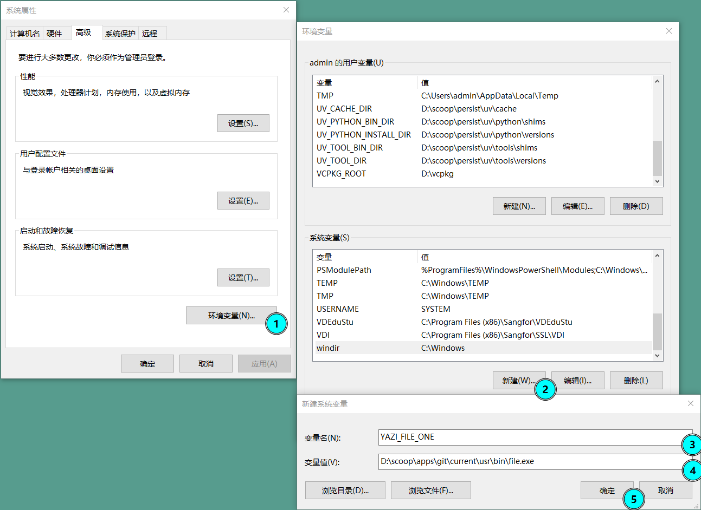

[Yazi](https://github.com/sxyazi/yazi) 是一款非常好用的命令行文件管理工具, 配合 Vim, 可以在非图形界面下很方便地浏览, 管理, 编辑文件.

Yazi 的官网提供了 [详尽的配置方式说明](https://yazi-rs.github.io/docs/installation), 但由于其兼容的系统较多, 每次想要找到一整套 windows 下的配置流程, 就比较麻烦. 因此这里总结了仅 windows 下的安装和基础配置方式.

## 安装

建议使用 scoop 安装. 没有 scoop 的可以先安装, 很好用.

```sh
scoop install yazi
```

## 安装依赖

### file 命令行工具

yazi 依赖 `file` 来判断文件类型, 因此基本是必须安装的.

yazi 不建议使用包管理器安装 `file` 命令行工具. 而是建议使用 `Git` 下的 `file` 命令行工具.

> 原文: We do not recommend installing `file` via Scoop or Chocolatey, since they cannot handle Unicode filenames (such as `oliver-sjöström.jpg`) properly and lack some required parameters.

如果电脑之前没有安装过 Git. 你可以去官网下载并安装; 如果安装了 scoop, 也可以直接使用 `scoop install git` 安装.

- 使用官方安装器安装的 Git, `file` 的路径通常是 `C:\Program Files\Git\usr\bin\file.exe`.
- 使用 scoop 安装的 Git, `file` 的路径通常是 `C:\Users\<用户名>\scoop\apps\git\current\usr\bin\file.exe`.

新建环境变量(想要快速到达界面, 可以按下 win + Q, 然后搜索 "编辑系统环境变量"), 键为 `YAZI_FILE_ONE`, 值为 `file` 的路径, 例如 `C:\Program Files\Git\usr\bin\file.exe`.



### 其它命令行工具

其它多种依赖建议直接使用 scoop 安装.

```sh
scoop install ffmpeg 7zip jq poppler fd ripgrep fzf zoxide resvg imagemagick
```

## 配置 y 启动

yazi 建议至少配置一个 `y` 命令, 以在退出 yazi 后, 保持最后的目录位置.

针对不同的 shell, 配置方式不同

### cmd(命令行提示符)

新建一个 `y.cmd` 文件(任何位置都行), 将其添加到环境变量(%PATH%). 内容如下:

```sh
@echo off

set tmpfile=%TEMP%\yazi-cwd.%random%

yazi.exe %* --cwd-file="%tmpfile%"

:: If the file does not exist, then exit
if not exist "%tmpfile%" exit /b 0

:: If the file exist, then read the content and change the directory
set /p cwd=<"%tmpfile%"
if not "%cwd%"=="" if exist "%cwd%\" (
	cd /d "%cwd%"
)
del "%tmpfile%"
```

### pwsh(PowerShell)

在 pwsh 终端, 打开或新建 `$PROFILE` 文件. 如果不知道如何打开, 以下命令可以参考:

```pwsh
# 查看 $PROFILE 的路径
$PROFILE
# 看文件是否存在
Test-Path -Path $PROFILE
# 如果不存在, 创建文件
New-Item -Path $PROFILE -ItemType File -Force

# 直接使用单条命令保证文件存在
if (!(Test-Path $PROFILE)) { New-Item -Type File -Path $PROFILE -Force }

# 用记事本打开文件
notepad $PROFILE
```

添加以下内容到 `$PROFILE` 文件中, 保存后重启 pwsh 终端即可生效.

```pwsh
function y {
	$tmp = (New-TemporaryFile).FullName
	yazi.exe @args --cwd-file="$tmp"
	$cwd = Get-Content -Path $tmp -Encoding UTF8
	if ($cwd -and $cwd -ne $PWD.Path -and (Test-Path -LiteralPath $cwd -PathType Container)) {
		Set-Location -LiteralPath (Resolve-Path -LiteralPath $cwd).Path
	}
	Remove-Item -Path $tmp
}
```

### nushell

在 nushell 中, 使用 `$nu.config-path` 找到配置文件路径, 打开并添加以下内容:

```sh
def --env y [...args] {
	let tmp = (mktemp -t "yazi-cwd.XXXXXX")
	^yazi ...$args --cwd-file $tmp
	let cwd = (open $tmp)
	if $cwd != $env.PWD and ($cwd | path exists) {
		cd $cwd
	}
	rm -fp $tmp
}
```

## 覆盖默认配置

新安装的 yazi 使用 [默认配置](https://github.com/sxyazi/yazi/tree/shipped/yazi-config/preset). 想要自定义, 我们需要新建配置文件, 在其中覆盖默认配置.

- %AppData%\yazi\config\yazi.toml
- %AppData%\yazi\config\keymap.toml
- %AppData%\yazi\config\theme.toml

如果不知道 %AppData% 实际上指什么, 可以在 cmd 中执行 `echo %AppData%`, 或者在 pwsh 中执行 `$env:AppData` 查看, 或者在 nushell 中执行 `$env.AppData` 查看.

例如, yazi 默认打开文件的方式是 code. 但我都用命令行了, 更希望使用 vim 打开, 所以我创建了 yazi.toml 文件, 并填入以下内容:

```toml
# A TOML linter such as https://github.com/tombi-toml/tombi can use this schema to validate your config.
# If you encounter any issues, please make an issue at https://github.com/yazi-rs/schemas.

#:schema https://yazi-rs.github.io/schemas/yazi.json

[opener]
edit = [
        { run = "${EDITOR:-vi} %s", desc = "$EDITOR",      for = "unix", block = true },
        { run = "vim %s",           desc = "vim",          for = "windows", block = true },
        { run = "code -w %s",       desc = "code (block)", for = "windows", block = true },
]
```

以上内容是参考 [官方默认配置](https://github.com/sxyazi/yazi/tree/shipped/yazi-config/preset) 文件, 仅重写需覆盖部分而来. 有其它修改需求可以去那里看源文件.
