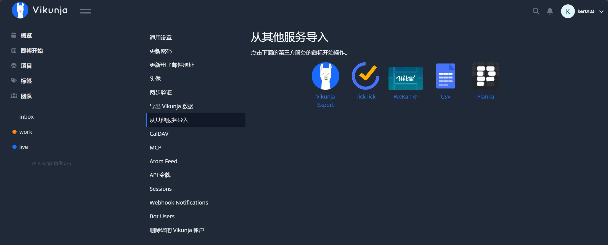
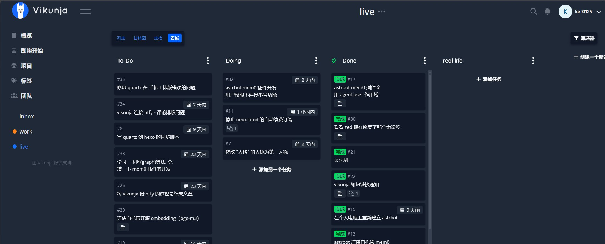
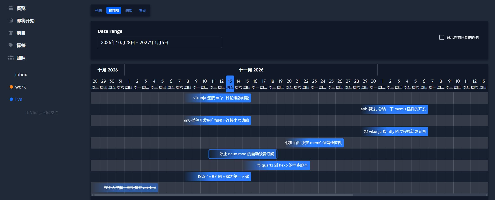
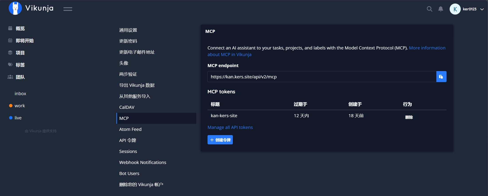
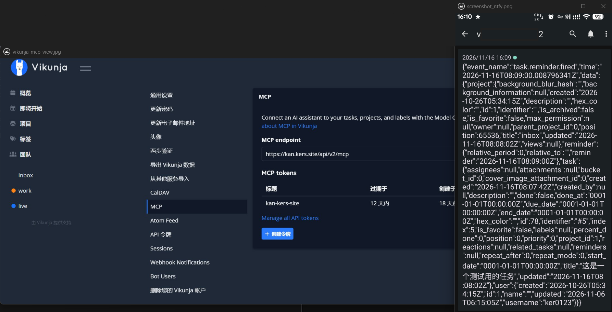

实例在 [kan.kers.site](https://kan.kers.site)

Vikunja 是一个开源的任务管理服务, 有看板, 甘特图等功能. 且外接手段众多, 例如我就使用了 MCP 让 agent 协助管理任务, 使用 webhook 让任务能触发手机通知提醒

<!--more-->

## vikunja

### 部署和导入数据

部署过程比较轻松写意, 看 [官方教程](https://vikunja.io/install/) 就好, 里面有各种系统和各种方式的部署指南.

如果之前有在别处使用看板等服务, 导入到这里也很轻松. 就算用的服务不在这张表里, 一般来说, 那些服务至少可以导出 csv 文件, 然后在这边导入.



实测 Trello 是可以的.

### 基本使用

一般在网页界面使用. 即使是手机上想使用, 也建议用浏览器打开. 官方虽然有手机软件, 但是用自托管服务的时候, 登录时得进浏览器, 然后每次打开都要登录... 基本没法用.



日常使用就是用项目分类任务主题, 进一步用桶分类任务状态.

简单使用的话, 可以只用 kanban. 新建任务, 然后拖来拖去就够了.

进一步的话, 可以给任务设置一个截止日期, 然后我们就能在 甘特图 看到它了. 现在我们不止能在 kanban 里拖动任务位置, 管理哪个任务正在做, 哪个任务做完了. 还能 **在 甘特图 里拖动任务在时间轴的位置, 预览和决定任务的 dead line**. 非常实用的功能.



还有列表和表格没有讲到. 列表的话, 可以收藏任务和手动为任务排序. 相当于更简化的看板; 表格基本上就全局预览任务的各个属性用.

### MCP

有时让 agent 能够管理你的任务安排, 是个很不错的点子. 也许让 agent 给你下达任务? 也许让 agent 日常读取你的任务安排然后自动帮助你?

vikunja 提供了 mcp 服务, 只要接入, agent 就能读写你的所有任务. 配置的地方是 `设置 > MCP`. 需要自己创建一个令牌, 用在请求头里面: `Authorization: Bearer YOUR_TOKEN`. 除此之外就是标准的 MCP 使用了, 这里不讲.



## WebHook 和 ntfy

> Vikunja 也提供了 Caldav 服务, 不过考虑到手机上日历软件各种不兼容, 并且 Caldav 服务本身也是残缺的(只支持 task), 因此不使用 Caldav 来实现通知提醒.

Webhook 是个非常简单粗暴, 但可自定义程度非常高的功能: 被特定操作触发后, 发送一条网络请求. 于是我们可以用这个网络请求触发手机上的通知.

刚好, ntfy 也是一个非常简单, 非常好用的通知提示软件. 它提供一个网址, 你可以用它的软件订阅这个网址, 也给这个网址发送网络请求. 而这个网址收到符合格式的网络请求之后, 就会给所有订阅了这个网址的终端发送一条通知.

二者的协议否非常简单, Vikunja 的 webhook , 目标地址自己填, 内容是一个 json 序列; ntfy 的接口有文档, 当然你也可以什么都不管, 直接在内容里面写 markdown, 它能处理的.

我们直接在 ntfy 官网创建一个免费的地址(每天限制 400 条消息, 个人完全够用). 然后填入 Vikunja 的 webhook. 选择创建任务时触发. 这样做的话, 会收到一条纯 json 字符序的提醒, 非常难看.



需要对 json 字符序做一些解析, 让它稍微好看一些. 不考虑新增实体的话, 我们可以直接在 url 里面写匹配模板, 从请求具体内容中取值填入 ntfy 准备好的接口. url 会长一些(最长不超过 2500, vikunja 会拒绝接受过长的 url).

过程略, 总之多次调试之后, 采用了下面这个 url, 效果还行, 并且引入了以下功能:

- 自动识别消息类型: 新建任务, 删除任务, 新建评论, 任务提醒, 任务超时
- 自动选择提醒等级: 任务提醒/任务超时时会有提示音, 其他仅静默通知.
- 可一键跳转到任务: 所有通知下面都有对应的任务 url, 可点击一键跳转到浏览器并显示任务详情

```html
https://ntfy.sh/vk-kers-8f3a91c2?tpl=yes&md=yes&t={{if%20eq%20.event_name%20"task.created"}}🆕%20{{else%20if%20eq%20.event_name%20"task.updated"}}✏️%20{{else%20if%20eq%20.event_name%20"task.comment.created"}}💬%20{{else%20if%20eq%20.event_name%20"task.comment.edited"}}🗯️%20{{else%20if%20eq%20.event_name%20"task.reminder.fired"}}🔔%20{{else%20if%20or%20(eq%20.event_name%20"task.overdue")%20(eq%20.event_name%20"tasks.overdue")}}❌%20{{end}}{{with%20.data.task}}{{.identifier}}%20{{.title}}{{else}}Vikunja{{end}}&m={{$f%20:=%20"01-02%2015:04"}}{{$l%20:=%20"2006-01-02T15:04:05Z07:00"}}{{$z%20:=%20"Asia/Shanghai"}}{{if%20or%20(eq%20.event_name%20"task.comment.created")%20(eq%20.event_name%20"task.comment.edited")}}{{.data.doer.username}}：{{printf%20"%25.300s"%20(regexReplaceAll%20"%3C[^%3E]*%3E"%20.data.comment.comment%20"")}}%0A{{else%20if%20eq%20.event_name%20"tasks.overdue"}}{{len%20.data.tasks}}%20个任务%0A{{else}}{{with%20.data.task}}{{if%20.description}}{{printf%20"%25.300s"%20(trim%20(regexReplaceAll%20"%3C[^%3E]*%3E"%20(regexReplaceAll%20"%3Cbr[^%3E]*%3E|%3C/p%3E"%20.description%20"%5Cn")%20""))}}%0A{{end}}{{if%20eq%20$.event_name%20"task.reminder.fired"}}提醒%20{{dateInZone%20$f%20(toDate%20$l%20$.data.reminder.reminder)%20$z}}%0A{{else}}{{with%20.reminders}}{{range%20.}}提醒%20{{dateInZone%20$f%20(toDate%20$l%20.reminder)%20$z}}%0A{{end}}{{end}}{{end}}{{if%20ne%20.start_date%20"0001-01-01T00:00:00Z"}}开始%20{{dateInZone%20$f%20(toDate%20$l%20.start_date)%20$z}}%0A{{end}}{{if%20ne%20.end_date%20"0001-01-01T00:00:00Z"}}结束%20{{dateInZone%20$f%20(toDate%20$l%20.end_date)%20$z}}%0A{{end}}{{if%20ne%20.due_date%20"0001-01-01T00:00:00Z"}}截止%20{{dateInZone%20$f%20(toDate%20$l%20.due_date)%20$z}}%0A{{end}}{{end}}{{end}}{{with%20.data.task}}[打开任务](https://kan.kers.site/tasks/{{.id}}){{end}}&priority={{if%20eq%20.event_name%20"task.reminder.fired"}}high{{else%20if%20or%20(eq%20.event_name%20"task.created")%20(eq%20.event_name%20"task.updated")%20(eq%20.event_name%20"task.comment.created")%20(eq%20.event_name%20"task.comment.edited")}}low{{else}}default{{end}}
```


注意, 在设置里的用户级 webhook 设置好任务提醒和任务超时之外, 在每个项目也可以设置多种触发方式的 webhook. 点击项目右侧三点图标, 就能看到.

上面的 url 可以在两处用. 在使用项目级 webhook 时, 建议仅勾选 "新建任务", "新建任务评论", 不要勾选 "编辑任务", "编辑评论". 在网页端的操作是实时保存的, 这意味着编辑时, 稍微停顿一下, 就会触发 webhook 发送通知.

## 总结

vikunja 部署相对简单, 跟着官方文档走就行了. 从别的地方迁移过来可以用 csv 格式中转.

日常使用时, 最基础的就是列表, 可以手动排序; 进一步是看板, 可以区分状态; 同时可以为任务设置日期然后配合甘特图进行时间安排.

vikunja 提供 MCP 给自己的 agent 使用.

vikunja 也提供 webhook, 可以接入 ntfy 来实现推送通知. 接入过程需要做格式转换, 本文给出了格式转换的实例.
