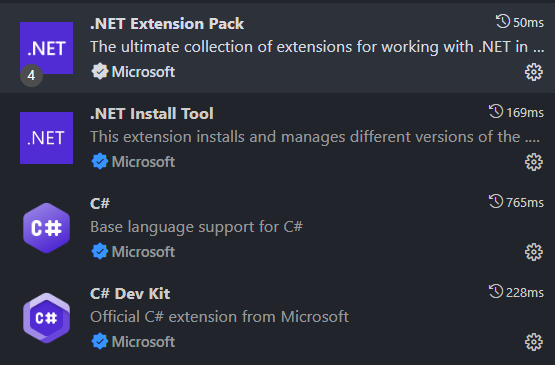
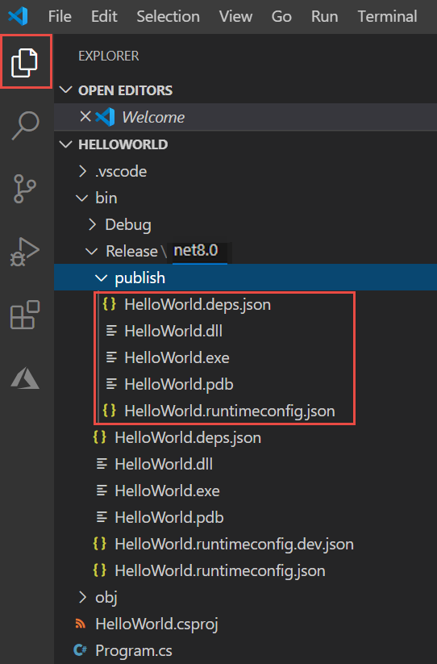
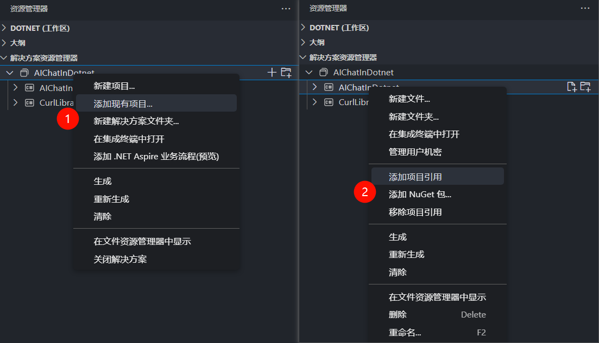
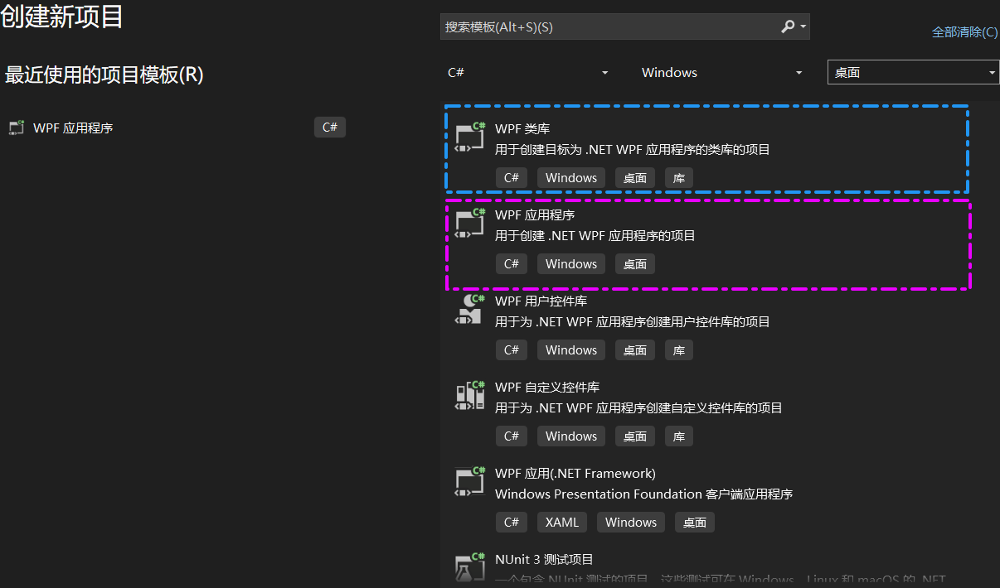

*这篇文章被搁置了, 因为我发现在语言本身设计上, 和制作简单 GUI 软件的需求上, Rust 和 iced 都略胜一筹, 因此学那些去了.*

## 印象

.NET 是纯正的面向对象程序构建方式, `using xxx` 引入程序包类似于 C/C++ 的 `#include` 引入头文件, 但是引入过程更加像引入类: 通过点运算符, 你可以引入程序包的不同层级, 并且不必担心头文件和源文件之间的复杂包含关系.

.NET 把项目与项目之间的联动也以类似于对象关系的方式实现. 你可以在一个项目中 "引入" 另一个项目, 这将创建一种类似于类之间的依赖关系, 如果引入的项目生成的是可执行程序, 这相当于使用外部程序; 如果引入的项目生成的是类库, 这相当于使用动态链接库.

## 构建项目

参照[VS Code 官方教程](https://learn.microsoft.com/zh-cn/dotnet/core/tutorials/with-visual-studio-code)和[Visual Studio 官方教程](https://learn.microsoft.com/zh-cn/dotnet/core/tutorials/with-visual-studio).

最基础的, 需要选择 .NET Framework 的版本, [在这里](https://dotnet.microsoft.com/zh-cn/download/visual-studio-sdks?cid=getdotnetsdk)下载需要的版本或者最新的版本. 如果是要打开运行已有的项目的话, 最好按照项目中记录的版本号, 选择下载对应的版本. 随着版本更新, .NET 的变化还是很大的.

### 使用 VS Code 创建项目

使用 Visual Studio Code 来编写调试程序能更好地了解 .NET 项目组成原理. 注意是通用的 .NET 项目, 而不是 Windows 上专用的 WPF 项目.

想要开始的话: 至少要安装 `C# Dev Kit` 扩展, 它将提供自动构建项目的功能, 否则也可以通过 `dotnet` 命令行来进行构建项目, 引入项目等操作. 其次还可以安装 .NET 扩展包, 对编程有一定帮助. 自己用的时候安装了这几个:



### .NET 项目结构浅析

使用扩展提供的命令(`.NET: New Project`)构建好项目之后, 项目结构中需要理解的地方:



如上图所示, 已发布的输出包含以下文件:

- **HelloWorld.deps.json**  
  这是应用程序的运行时依赖项文件. 它定义运行应用所需的 .NET 组件和库(包括包含应用程序的动态链接库). 有关详细信息, 请参阅运行时配置文件.
- **HelloWorld.dll**  
  这是应用程序的依赖于框架的部署版本. 若要运行此动态链接库, 请在命令提示符处输入 `dotnet HelloWorld.dll`. 运行应用的方法适用于安装了 .NET 运行时的任何平台.
- **HelloWorld.exe**(HelloWorld 在 Linux 或 macOS 上).  
  这是应用程序的依赖于框架的可执行文件版本. 该文件特定于操作系统.
- **HelloWorld.pdb**(对于部署是可选的)  
  这是调试符号文件. 无需与应用程序一起部署此文件, 但应在调试应用程序的已发布版本时保存该文件.
- **HelloWorld.runtimeconfig.json**  
  这是应用程序的运行时配置文件. 它标识了您的应用程序是为哪个 .NET 版本构建和运行的. 还可以向其添加配置选项. 有关详细信息, 请参阅 .NET 运行时配置设置.

值得注意: 发布类库时需要指定 `TargetFramework`, 在 `xxx.csproj`(xxx 是项目名)中修改, 它决定了能使用这个类库的 .NET Framework 版本.

使用第三方库的时候, 就像使用非 C++ 标准库一样, 需要把第三方类库 "引入" 项目(当然也可以在项目内新建一个类库, 引入到另一个类库). 在 Visual Studio Code 中, 操作流程大致如下:



> 不难看出. .NET 软件框架的主要特征, 就是以 `.NET 项目` 为基础单位, 每个项目单独编写和编译, 其主要产物可能是 `链接库(.dll)` 或 `可执行程序(.exe)`. `.NET 项目` 之间再相互引用, 组合而成一整个项目.
> 
> 而 .NET Framework 则为全局的 .NET 项目提供了程序包, 例如 `System.IO` 程序包控制输入输出, `System.Text.Json` 程序包提供 Json 相关功能... WPF 作为 .NET 类型的子集存在, 其主要特征就是提供了 `System.Windows` 程序包.

### 使用 VS 创建项目

如果是在 Visual Studio 2022(或者其他版本), 创建 WPF 项目相当简单, 只需安装好负载(.NET 桌面开发)要选好项目模板(WPF 应用程序)就行.

如果是要创建供其他项目使用的类库的话, 选 WPF 类库.



创建好项目后, 项目配置, 编译运行均为图形界面操作, 与 C++ 项目基本一致, 不再赘述.

### 使用 NuGet 共享包

类似于 .NET 框架的包管理器.

目前好像直接用 `dotnet add package Newtonsoft.Xxxx` 就可以引入 `nuget.org` 的第三方包了. NuGet 的介绍见[官方教程](https://learn.microsoft.com/zh-cn/nuget/what-is-nuget). 这里先不写.

在 VS 中, 我们可以直接通过 项目 > 管理 NuGet 程序包 来图形化管理第三方包.

我们还可以在 `nuget.org` 注册账号, 上传自己制作的包...

## 编写内容

参见[官方教程](https://learn.microsoft.com/zh-cn/dotnet/desktop/wpf/).

因为涉及到图形界面元素组织, 所以一般用 Visual Studio 进行编写.

### 窗口

WPF 应用使用 `xaml` 文件表示窗口, 以类似 `xml` 文件的形式编写界面元素信息. 通常来说, `xaml` 文件下还绑定着一个 `.xaml.cs` 文件, 其用以响应元素上发生的事件.

可以打开 VS 的 `工具箱` 窗口, 并选择 xaml 文件, 然后通过拖动元素的方式来新建元素, 再使用属性窗口来详细设定元素参数.

直接在可视化窗口中双击按钮等元素, 可以快速创建该元素的回调函数(正式运行时, 点击该元素会执行的函数), 也可以右键并跳转到改元素的对应函数, 不只是回调函数, 也可以设置其他的绑定内容.

### C# 语言高级功能

C# 提供了一些额外功能来帮助构建程序, 它们大多是对某些设计的简化, 十分有用. 适当了解对看懂别人的项目或者直接写项目都有帮助

#### 委托 Delegate

参考[C# 委托(Delegate) | 菜鸟教程](https://www.runoob.com/csharp/csharp-delegate.html).

> 在 C# 中, 委托(Delegate) 是一种类型安全的函数指针, 它允许将方法作为参数传递给其他方法.
> 
> C# 中的委托(Delegate)类似于 C 或 C++ 中函数的指针. 委托(Delegate) 是存有对某个方法的引用的一种引用类型变量, 引用可在运行时被改变.
> 
> 委托在 C# 中非常常见, 用于事件处理, 回调函数, LINQ 等操作.
> 
> 所有的委托(Delegate)都派生自 System.Delegate 类.

我来一句话总结的话, 就是类型安全的回调函数用法.

```C#
// 声明委托的语法:
// public delegate <return type>  <delegate-name> <parameter list>
// public delegate 返回类型       委托名          (参数类型 参数名, ...);

// 定义一个 (cmd, rcv) -> bool 类型的委托
public delegate bool SqlCmd(string cmd, List<string> rcv);

// 假设别处已经书写了这么一个 "回调函数"
public bool SqlGetFirstLine(string cmd, List<string> rcv)
{
  // ... 发送sql命令, 并保存收到的第一行数据到 rcv
  return ret;
}
public bool SqlGetAllLine(string cmd, List<string> rcv)
{
  for(...)
  {
    // ... 发送sql命令, 并保存收到的第一行数据到 rcv
  }
  return ret;
}

// 实例化和使用
public static Main()
{
  // 将回调函数作为"委托"对象的初始化参数
  SqlCmd SqlGetDeleget = new SqlCmd(SqlGetFirstLine)
  // 执行委托
  List<string> lines;
  SqlGetDeleget("select * where name equals ker0123", lines);
  // 切换实际调用函数, 再执行委托
  SqlGetDeleget = new SqlCmd(SqlGetAllLine);
  SqlGetDeleget("select * where name equals ker0123", lines);
}

```

相同类型的委托, 还能够用 `+`, `-`, `+=`, `-=` 拼接成新的委托, 或者排除其中某个委托, 达到一条命令执行两个同类委托的效果.

#### 事件 Event 以及 "发布-订阅" 模型

...
