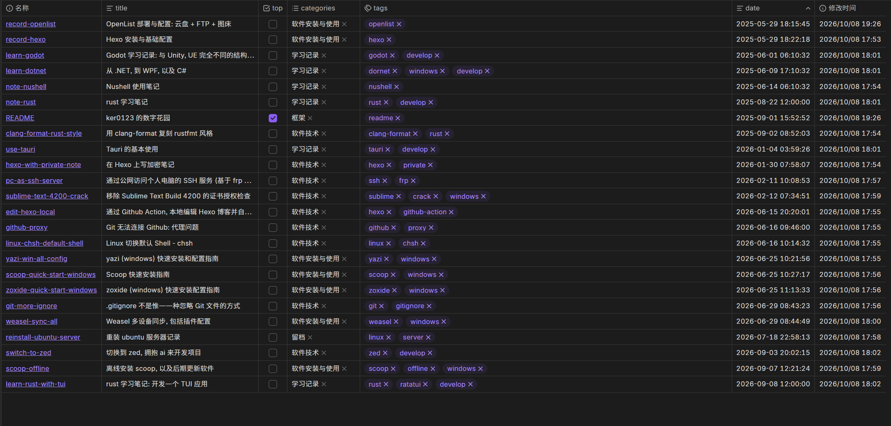
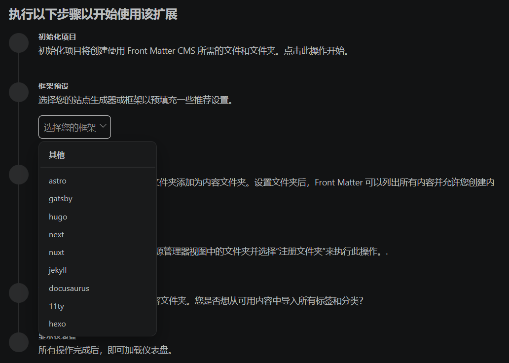

---
title: 从 hexo 迁移到 quartz
date: 2026-10-08
tags:
  - hexo
  - quartz
---

## 迁移前夕

之前, 我用 [hexo](https://github.com/hexojs/hexo) 这个静态博客项目, 写自己的在线同步笔记, 然后可以在公网访问和阅读. 最早一篇笔记在 2025/05/29 写下, 是一篇讲我怎么部署 alist(另外一个网盘服务) 的文章(见 [OpenList 部署与配置](app-startup/record-openlist.md)), 到现在已经一年多了. 期间断断续续写了总共 20 多篇文章, 对于一年零五个月的跨度, 实在太少了.

中间总结过几次原因, hexo 项目也变样了很多次. 不过写作频率还是小停两个月, 大停四个月... 总的时间线可以看看下面这张, 本次重构前的总观图:

不难看出非常惨淡了.

总结原因的话, 就是每次写笔记都太 "正式" 了. 借用 Quartz 项目作者讲数字花园时的原文:

> My first blog made me scared of posting. I was scared of putting things into the public because I was anxious about all the different ways people could perceive it, both in the present and in the future. What if I posted something that people thought was _stupid_? Maybe somebody would see my current work in the future and look down on me for how naive my thinking was.
> 
> 我的第一个博客让我害怕发帖. 我害怕把东西公开, 因为我担心人们会以各种不同的方式看待它, 无论是现在还是将来. 如果我发了一些人们认为 _愚蠢_的东西怎么办? 也许将来有人会看到我现在的作品, 并因为我当时的想法多么幼稚而看不起我.

我在后期, 每次有做笔记的需要, 甚至只要想到要在这个 hexo 上做笔记, 我就开始假想别人会怎么看我写的东西了, 我这里是不是要注意下措辞, 那里是不是要引用些材料, 这些表达是不是太讨人厌了... 然后就是 "算了吧, 这点东西记在脑子里就行, 写出来给谁看? 大家明明可以在其他地方看到更好的表述" ---- 这种想法一出来, 就基本上不会去写作了.

中间也有想过换一换博客框架. 用 webdav 同步怎么样? 试试其他类似的框架怎么样? 都试过, 不过从效果看, 基本没什么用.

> "试试其他类似的框架" 这个想法, 我专门去实践了 ---- 写 hexo 期间, 我用过 vscode 上一个专门管理各种博客的插件, 叫 [front-matter](https://frontmatter.codes), 多方对比了它支持的博客框架:
> 
> 
> 
> 最后发现其他框架要么是比 hexo 更重, 要么是用的框架语言和实现方式我不喜欢, 最后本次尝试退而求次, 以换了换 hexo 主题告终.

到最后可能还是我的思想问题: 我不应该把一个笔记写得这么----还是那个形容: **正式**. 最好是随便写写, 到处能看, 然后觉得有意思成体系的, 公开一下就好.

其实另外还有个导致 "正式感" 太强的点: 我一直用 git 同步这个笔记仓库, 做点改动就得 add, 然后 `commit -m`. 再写点提交信息. 不这么做, 到时候回到家里就会发现刚写的东西这边看不到了, 第二天来到公司一 push, 又多出几个冲突要解决.

于是今天问了问见多识广的 ai 大人, 它告诉我 Quartz 这个项目能解决我的痛点, 还能适配 obsidian(我喜欢用它的数据库插件来统一管理文章 tag 这些). 于是就把之前写在 hexo 框架内的文章都搬到这边来了, 现在做第一次 commit.

## 迁移

我已经懒得写是迁移细节了, 以后自己再去找官方教程就可以.

大体方案是:

1. 在 github 上 fork quartz 仓库
2. 把 hexo 的文章复制到 quartz 项目的 content/ 目录里. 然后 commit 到 github 的远程仓库.
3. 用 cloudflare 免费创建一个 page, 连接 github 仓库, 设置每次 push 后自动部署
4. 添加 DNS 记录, 将 quartz.kers.site 这个域名解析到 cloudflare 生成的 page 地址.

~~忽然发现自己事实上拽英文太多了~~

## 迁移之后

迁移之后主要的改动就是文章文件的结构, 大概经过 3 次修改后, 确定为:

- 文件使用全英文, 写 front-matter 的 title 词条, 配合 index, 让最终界面显示为对应中文.
- 用文件夹代替分类(category)属性, 然后保留 tag.
- tag 怎么打的话, 能看一眼 tag 知道文章描述对象就行. 有时会额外带上大 tag, 例如 windows 这种.
- 附件放在文件同级的 _assets 文件夹里, 只用基本的 markdown 语法写链接.
- quartz 的主题插件, 由于是批量转换的 obsidian 主题, 在处理引用语法时会丢失缩进, 因此不使用主题插件, 回退到原生主题.
